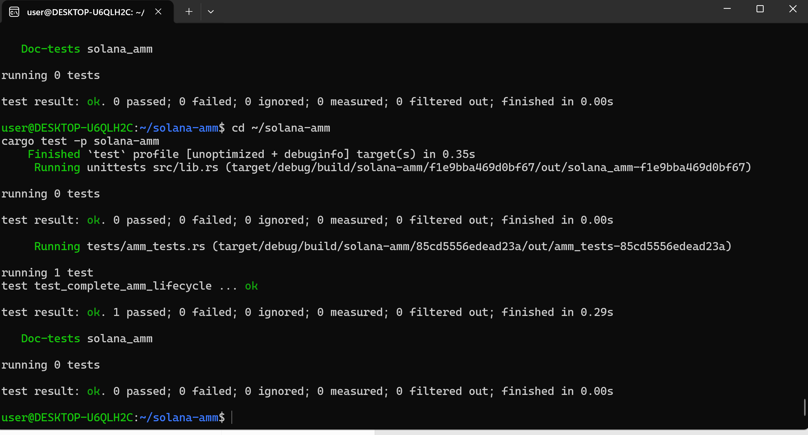

# Solana AMM — Constant Product Market Maker

## Overview

This project implements an Automated Market Maker (AMM) on Solana using Rust and the Anchor framework.

It uses a Constant Product Market Maker (CPMM) model. Users can provide liquidity, receive LP tokens, swap between two tokens, and withdraw liquidity.

The CPMM logic is implemented directly in the program without relying on an external AMM library.

## Features

- Initialize an AMM liquidity pool.
- Deposit two tokens into the pool.
- Mint LP tokens to liquidity providers.
- Swap Token A for Token B.
- Swap Token B for Token A.
- Charge swap fees and allocate protocol fees.
- Withdraw liquidity and burn LP tokens.

## CPMM Formula

The AMM follows the constant product invariant:

`x * y = k`

Where:

- `x` is the reserve of Token A.
- `y` is the reserve of Token B.
- `k` is the constant product, which the swap mechanism aims to preserve.

The output amount is calculated using:

`amountOut = (amountInWithFee * reserveOut) / (reserveIn * 10000 + amountInWithFee)`

The fee configuration is:

| Fee | Amount |
|---|---:|
| Total swap fee | 30 basis points (0.30%) |
| Protocol fee | 5 basis points (0.05%) |
| LP fee | 25 basis points (0.25%) |

## Technology Stack

- Rust
- Solana
- Anchor Framework
- Anchor SPL
- LiteSVM
- Cargo

## Program ID

`uRMgTCNZMr6KURp4KVsAWXb1SU77TFdrDwuMqTr8LcA`

## Project Structure

```text
solana-amm/
├── Anchor.toml
├── Cargo.toml
├── Cargo.lock
├── programs/
│   └── solana-amm/
├── screenshots/
│   └── amm-tests-passing.png
└── README.md
```

## Build and Test

Make sure Rust, Solana CLI, and Anchor are installed.

Build the program:

```bash
anchor build
```

Run the complete test suite:

```bash
cargo test -p solana-amm
```

## Test Results

The integration test `test_complete_amm_lifecycle` verifies:

1. AMM pool initialization.
2. Liquidity deposit and LP token minting.
3. Token A to Token B swap and protocol fee.
4. Token B to Token A swap and protocol fee.
5. Liquidity withdrawal and LP token burning.

The complete AMM lifecycle integration test passed:

```text
running 1 test
test test_complete_amm_lifecycle ... ok

test result: ok. 1 passed; 0 failed; 0 ignored
```

The test uses LiteSVM to execute the program and verify the AMM lifecycle.

## Test Screenshot

The screenshot showing the passing test is included in the repository:



## Extension Challenge: CPMM Without an External Library

The CPMM calculation is implemented directly in Rust. The program calculates swap output using the pool reserves and the configured fee parameters, rather than delegating the AMM calculation to an external AMM library.

This helped demonstrate how a constant-product liquidity pool works internally.

## Extension Challenge: Mitigating Downtime in DeFi Applications

Downtime can prevent users from accessing a DeFi application or submitting transactions. Some practical mitigation strategies include:

1. **RPC redundancy:** Use multiple reliable Solana RPC providers and switch to a healthy provider if the primary endpoint becomes unavailable.
2. **Retry mechanisms:** Use controlled retries with exponential backoff for temporary network failures.
3. **Transaction monitoring:** Monitor transaction submission, confirmation, and failure states, and provide clear feedback to users.
4. **Backend redundancy:** Run redundant backend services and health checks to reduce single points of failure.
5. **Monitoring and alerts:** Monitor RPC availability, application errors, latency, and transaction failures.
6. **Incident response:** Maintain backups, recovery procedures, and a documented incident-response plan.
7. **Safety controls:** Where appropriate, use carefully designed emergency pause mechanisms with strict access controls and clear recovery procedures.

These strategies improve reliability and help protect users during infrastructure failures.

## Learning Outcomes

Through this project, I gained practical experience with:

- Building Solana programs using Rust and Anchor.
- Managing token accounts and token transfers.
- Implementing a constant-product AMM.
- Calculating swap fees and protocol fees.
- Testing Solana programs with LiteSVM.
- Understanding reliability and downtime mitigation in DeFi applications.

## Author

**George Tsolos**
# solana-amm
